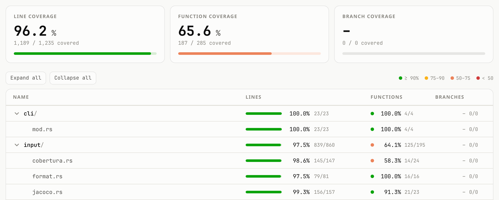

<picture>
  <source media="(prefers-color-scheme: dark)" srcset="./img/logo-dark.svg">
  
</picture>

[![Crate][crate-image]][crate-url]
[![Build Status][github-actions-image]][github-actions-url]
[![Test coverage][codecov-image]][codecov-url]
[![MIT license][license-image]][license-url]

[crate-image]: https://img.shields.io/crates/v/coviz-cli?style=flat-square
[crate-url]: https://crates.io/crates/coviz-cli

[github-actions-image]: https://img.shields.io/github/actions/workflow/status/aesy/coviz/ci.yml?branch=main&style=flat-square
[github-actions-url]: https://github.com/aesy/coviz/actions

[codecov-image]: https://img.shields.io/codecov/c/github/aesy/coviz?style=flat-square
[codecov-url]: https://codecov.io/github/aesy/coviz

[license-image]: https://img.shields.io/github/license/aesy/coviz?style=flat-square
[license-url]: https://github.com/aesy/coviz/blob/main/LICENSE

Turns a code coverage report into a modern, self-contained HTML page you can browse or share. It reads LCOV, 
JaCoCo XML, Cobertura XML and LLVM JSON. `Coviz` is available as a native single-binary Linux/macOS/Windows CLI tool.

[Visit the website](https://aesy.github.io/coviz/) to see what it can do.



## Usage

Point `Coviz` at a coverage report and either write the result to a file or open it in your browser:

```shell
coviz --input coverage.info --open            # open report in the browser
coviz --input jacoco.xml --output report.html # write report to file
```

With only `--open`, the report is written to the system's temp directory before it is opened.

The report is a single HTML file with no external requests, so it can be attached to a CI run or sent to someone as-is.
Source files found on disk are embedded so every file can be read with its covered and missed lines highlighted. Relative
paths in the coverage report are resolved against the report's own directory, and files over 2 MB are left out.

CLI options can be viewed via the CLI's help command:

```shell
coviz --help
```

```
Code coverage report visualizer

Usage: coviz [OPTIONS] --input <INPUT> <--output <OUTPUT>|--open>

Options:
  -i, --input <INPUT>    Coverage report to visualize
  -f, --format <FORMAT>  Input format, determined from the input file name or contents when omitted [possible values: lcov, jacoco, cobertura, llvm-json]
  -o, --output <OUTPUT>  Write the HTML report to this file
      --open             Open the report in the default browser
  -h, --help             Print help
  -V, --version          Print version
```

### Supported formats

| Format         | `--format`  | Detected from                                   | Produced by, for example                                                    |
|----------------|-------------|-------------------------------------------------|-----------------------------------------------------------------------------|
| LCOV           | `lcov`      | `.lcov`/`.info` extension or `lcov` in the name | `cargo llvm-cov --lcov`, Jest/Vitest `coverage/lcov.info`, `lcov --capture` |
| JaCoCo XML     | `jacoco`    | `.xml` with a `<report>` root element           | Gradle `jacocoTestReport`, Maven `jacoco:report`                            |
| Cobertura XML  | `cobertura` | `.xml` with a `<coverage>` root element         | coverage.py `coverage xml`, Coverlet `coverage.cobertura.xml`               |
| LLVM JSON      | `llvm-json` | `.json` extension                               | `llvm-cov export -format=text`, `cargo llvm-cov --json`                     |

If the file name doesn't give the format away, `Coviz` looks at the content instead. Pass `--format` to skip
detection entirely.

## Installation

### Binaries

The latest stable `Coviz` releases are available as [prebuilt binaries under GitHub
releases](https://github.com/aesy/coviz/releases) for Linux (x86_64 and ARM64, statically linked), macOS (Apple Silicon) and
Windows (x86_64). Binaries for other platforms have to be built from source.

#### Linux

Example on how to download and install a `Coviz` binary using [curl](https://curl.se/):

```shell
curl -L https://github.com/aesy/coviz/releases/latest/download/coviz-linux-amd64 -o coviz
chmod +x coviz
sudo mv coviz /usr/local/bin
```

On ARM64, download `coviz-linux-arm64` instead.

#### macOS

Example on how to download and install a `Coviz` binary using [curl](https://curl.se/):

```shell
curl -L https://github.com/aesy/coviz/releases/latest/download/coviz-macos-arm64 -o coviz
chmod +x coviz
sudo mv coviz /usr/local/bin
```

#### Windows

Example on how to download a `Coviz` binary using [curl](https://curl.se/):

```shell
curl -L https://github.com/aesy/coviz/releases/latest/download/coviz-windows-amd64.exe -o coviz.exe
```

### Cargo

`Coviz` is published on [crates.io](https://crates.io/crates/coviz-cli) as `coviz-cli` and installs the `coviz` binary:

```shell
cargo install coviz-cli
```

### Build from source

To build the CLI, run the following command:

```shell
cargo build --target <target> --release
```

The resulting binary can be found in the repositories root directory under `target/<target>/release/` called `coviz`.

The `<target>` options can be found
at [Rust's platform support page](https://doc.rust-lang.org/nightly/rustc/platform-support.html).

## Development

#### Prerequisites

* [Rust Stable 1.100.0+](https://www.rust-lang.org/tools/install)
* [Cargo](https://doc.rust-lang.org/cargo/getting-started/installation.html)
* [Rust Nightly](https://rust-lang.github.io/rustup/concepts/channels.html) - only for formatting, see [Linting](#linting)
* [Node.js](https://nodejs.org/) - only needed to change the HTML report UI, see [Report UI](#report-ui)

#### Build

To compile the project, simply issue the following command:

```shell
$ cargo build
```

#### Test

##### Linting

This project uses [rustfmt](https://github.com/rust-lang/rustfmt) for formatting and
[clippy](https://github.com/rust-lang/rust-clippy) for linting. The formatting config uses unstable options, so
rustfmt has to run on the nightly channel:

```shell
$ cargo +nightly fmt
$ cargo clippy --all-targets
```

##### Unit/Integration/Doc Testing

All code that goes into main must pass all tests. To run all tests, use:

```shell
$ cargo test
```

#### Report UI

The HTML report is authored as a [Vite](https://vite.dev/) + [Preact](https://preactjs.com/) project under
[`cli/web`](/cli/web) and compiled into a single HTML file that the binary embeds and fills with data at runtime. The built file
is committed, so `cargo build` needs no Node.js toolchain; run `npm run build` in the `cli/web` directory to regenerate it
after changing the UI. See [cli/web/README.md](/cli/web/README.md) for details.

## Contribute

Use the [issue tracker](https://github.com/aesy/coviz/issues) to report bugs or make feature requests. Pull requests are
welcome, but it may be a good idea to create an issue to discuss any changes beforehand.

## License

MIT, see [LICENSE](/LICENSE) file.
